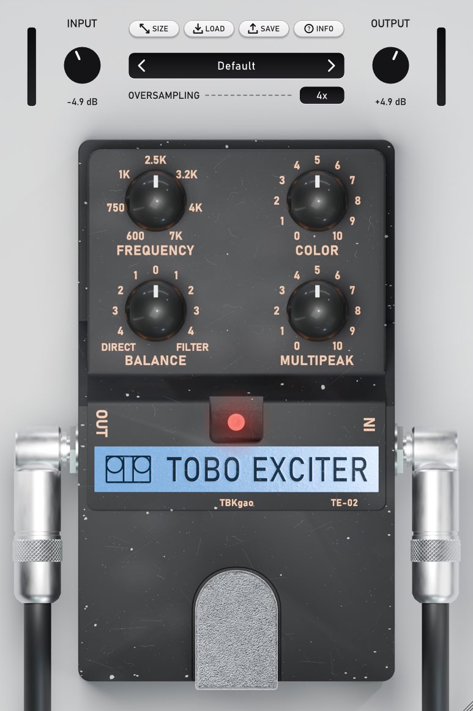

# Tobo Exciter — a 1980s exciter pedal as a plug-in, modeled on hardware measurements

Tobo Exciter (TE-02) is a free VST3 effect for Windows. It models an exciter pedal of the 1980s: a filter with a sharp peak, six fixed resonances and the way the circuit clips. It adds a bright, biting edge above the note. With the knobs turned up, the pedal sings at a single pitch of its own on top of what you play.

- **Format**: VST3, 64-bit Windows, mono or stereo
- **Price**: free
- **License**: AGPL-3.0-or-later (the source is in this repository)

This plug-in is an independent work. It is not affiliated with, endorsed by, or sponsored by any hardware manufacturer.

<!-- Generated from manual/manual_en.md by tools/make_docs.py. Change the source, not this file. -->

**Download:** https://github.com/tobokegao/ToboExciter/releases/latest  
**Demo video:** [tobo_exciter_demo.mp4](https://github.com/tobokegao/ToboExciter/releases/latest/download/tobo_exciter_demo.mp4) (a guitar through a fuzz, with Tobo Exciter in front of it and its knobs moved)  
**日本語:** [README_ja.md](README_ja.md)

The full manual is also in the download as a PDF (`ToboExciter_manual_en.pdf`; `ToboExciter_manual.pdf` is the Japanese version).

## Documentation

- [Features](docs/features.md)
- [Install](docs/install.md)
- [Quick start](docs/quick-start.md)
- [The panel](docs/the-panel.md)
- [Presets and preset files](docs/presets-and-preset-files.md)
- [Parameters for automation](docs/parameters-for-automation.md)
- [Latency and oversampling](docs/latency-and-oversampling.md)
- [Tested environment and known limits](docs/tested-environment-and-known-limits.md)
- [Troubleshooting](docs/troubleshooting.md)
- [Building from source](docs/building-from-source.md)
- [License and credits](docs/license-and-credits.md)
- [Version history](docs/version-history.md)

## License

AGPL-3.0-or-later. See `LICENSE`, `CREDITS.md` and `THIRD_PARTY_LICENSES.txt`.
