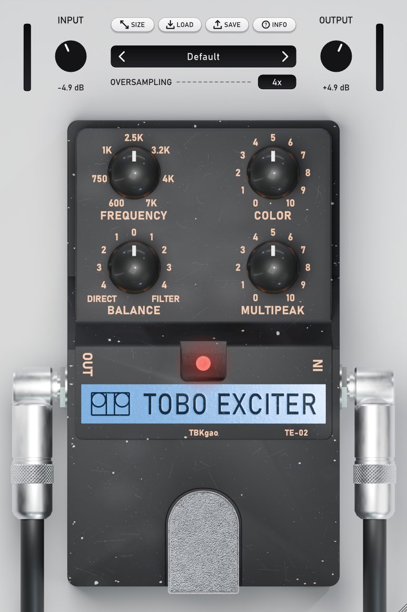
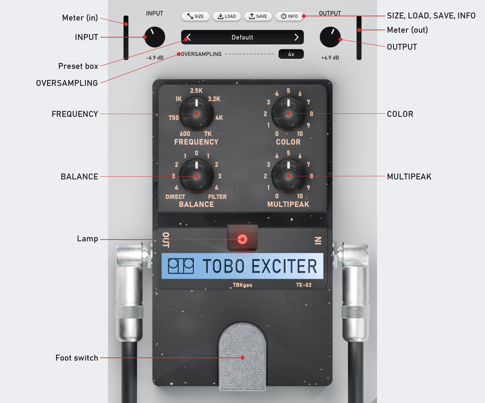

# Tobo Exciter — 1980年代のエキサイターペダルを、実機の計測をもとに再現したプラグイン

<!-- manual/manual_ja.md から tools/make_docs.py が作るファイル。直すときは原稿を直して作り直す -->

Tobo Exciter（TE-02）は、Windows用の無料のVST3エフェクトです。1980年代のエキサイターペダルを再現しています。再現しているのは、鋭いピークを持つフィルター、6つの固定の共振、回路の歪み方です。弾いた音の上に、明るく刺さるような倍音が加わります。ノブを上げると、弾いた音とは別に、一定の音程でペダルが歌うように鳴ります。



- **形式**: VST3、64ビットWindows、モノラルまたはステレオ
- **価格**: 無料
- **ライセンス**: AGPL-3.0-or-later（ソースコードはこのリポジトリにあります）

このプラグインは独立した作品です。どのハードウェアメーカーとも提携しておらず、公認・協賛も受けていません。

**ダウンロード:** https://github.com/tobokegao/ToboExciter/releases/latest  
**デモ動画:** [tobo_exciter_demo.mp4](https://github.com/tobokegao/ToboExciter/releases/latest/download/tobo_exciter_demo.mp4)（ファズを通したギターの前段にTobo Exciterを置き、ノブを動かしています）  
**English:** [README.md](README.md)

説明書はダウンロードしたZIPファイルにもPDFで入っています（日本語版は`ToboExciter_manual.pdf`、英語版は`ToboExciter_manual_en.pdf`）。

## 特長

- **計測をもとにしたモデル**: 実機の周波数特性と歪みを、テスト信号（サインスイープ）で計測しました。計測は複数の入力レベルと多くのノブ位置で行いました。できたモデルは、同じ実機にギターを通した録音（リアンプ）と比べて確認しました。
- **ペダルと同じ4つのノブ**: FREQUENCY・COLOR・BALANCE・MULTIPEAKです。ノブの効き方のカーブは、計測した実機に合わせています。
- **ノイズの出ないフットスイッチ**: フットスイッチをクリックすると、短いクロスフェードでエフェクトがオン・オフします。プチッというノイズは出ません。DAWのバイパスでも同じクロスフェードになります。
- **INPUTとOUTPUT、メーター**: INPUTで、ペダルをどれだけ強く歪ませるかを決めます。メーターは、モデルに入るレベルとプラグインから出るレベルを表示します。
- **オーバーサンプリング**: 2x・4x・8xから選べます。このモデルは強く歪むので、高い設定ほど折り返しノイズが減ります。
- **プリセット**: 内蔵のプリセットが8つあります。設定をプリセットファイルとして保存し、読み込むこともできます。
- **大きさを変えられる画面**: 60%から200%まで、メニューで選ぶか、ウィンドウの角をドラッグして変えられます。

## インストール

1. [最新のリリース](https://github.com/tobokegao/ToboExciter/releases/latest)から`ToboExciter_0.1.0_win64.zip`をダウンロードして展開します。
2. `Tobo Exciter.vst3`フォルダーを、中のファイルだけでなくフォルダーごと`C:\Program Files\Common Files\VST3\`にコピーします。
3. DAWを起動して、プラグインを再スキャンします。REAPERでは`Options` > `Preferences` > `Plug-ins` > `VST` > `Re-scan`です。
4. プラグインは**Tobo Exciter**（Tobokegao）という名前で表示されます。

更新するときは、DAWを閉じてからフォルダーを新しいものに置き換えます。アンインストールするときは、フォルダーを削除します。保存したプリセットファイルは、保存した場所に残ります（初期設定では`ドキュメント\Tobo Exciter Presets`）。

インストーラーも追加のランタイムも必要ありません。コード署名はしていません。

## 基本的な使い方

1. ギターのトラックで、アンプや歪みエフェクトの前にTobo Exciterを入れます。このペダルは、ギターとアンプの間につなぐものとして作られています。
2. 音を鳴らします。4つのノブがすべて12時の位置でも、音に明るい輪郭が付きます。
3. **BALANCE**を右に回すと、フィルターを通った音が増え、元の音が減ります。
4. **COLOR**を右に回すとフィルターのピークが鋭くなります。ピークの位置は**FREQUENCY**で決めます。
5. **MULTIPEAK**を右に回すと、6つの固定のピークが加わります。
6. **INPUT**で歪みの強さを好みに合わせ、**OUTPUT**で音量を戻します。
7. **フットスイッチ**をクリックして、エフェクトなしの音と聴き比べます。

一定の音程で鳴り続ける音は、プリセットの**One Note**と**Thin Scream**で試せます。

## 画面の各部



| 部品 | 働き |
|---|---|
| **FREQUENCY** | フィルターが効き始める周波数です。画面の目盛りは、実機と同じ600 Hz〜7 kHzです。モデルのフィルターは、計測値に合わせて約690 Hz〜6.8 kHzの範囲で動きます。 |
| **COLOR** | フィルターのピークの鋭さです。左いっぱいではなだらかで、右いっぱいでは共鳴して鳴ります。 |
| **BALANCE** | 元の音とフィルターを通った音を混ぜます。左いっぱいで元の音だけ、右いっぱいでフィルターを通った音だけになります。 |
| **MULTIPEAK** | 1〜5 kHzにある6つの固定のピーク（約1.0・1.4・1.9・2.4・3.5・5.0 kHz）を加えます。 |
| **フットスイッチ** | クリックするとエフェクトがオン・オフします。オンの間は、ネームプレートの上のランプが点灯します。 |
| **INPUT** | モデルに入るレベルです（-30〜+30 dB）。ペダルをどれだけ強く歪ませるかが決まります。 |
| **OUTPUT** | モデルから出るレベルです（-30〜+30 dB）。 |
| **メーター** | 左はモデルに入るレベル（INPUTのあと）、右はプラグインから出るレベルです。いちばん下が-60 dBです。0 dBFSを超えた部分は赤で表示します。 |
| **プリセットの枠** | プリセットの名前を表示します。左右の矢印で、前後の内蔵プリセットに切り替えます。 |
| **OVERSAMPLING** | クリックするたびに2x・4x・8xが切り替わります。 |
| **SIZE** | 画面の大きさ（75%・100%・125%・150%・200%）を選ぶメニューを開きます。 |
| **LOAD** | ファイルからプリセットを読み込みます。 |
| **SAVE** | いまの設定をプリセットファイルとして保存します。 |
| **INFO** | プラグインと各部品の短い説明を表示します。どこかをクリックすると閉じます。 |

- ノブは上下にドラッグして回します。ダブルクリックすると初期値に戻ります。
- ウィンドウの右下の角をドラッグすると、画面を大きく・小さくできます。縦横の比は変わりません。大きさはプロジェクトと一緒に保存されます。

### INPUTとOUTPUTの初期値

このペダルは、ギターの音量によって効き方が変わります。大きな音ほど強く歪みます。初期値（INPUT -4.9 dB、OUTPUT +4.9 dB）は、モデルを確認したときの録音環境に合わせた値です。お使いの録音は、それより音量が大きかったり小さかったりする場合があります。効きが弱いときは、INPUTを上げ、同じ分だけOUTPUTを下げます。きつすぎるときは、その逆にします。

## プリセットとプリセットファイル

内蔵の8つのプリセットは、4つのノブを設定します。INPUT・OUTPUT・OVERSAMPLINGは変わりません。

| プリセット | FREQUENCY | COLOR | BALANCE | MULTIPEAK |
|---|---|---|---|---|
| Default | 5 | 5 | 5 | 5 |
| Gentle Air | 6.5 | 3 | 3.5 | 4 |
| Bite | 5 | 7.5 | 5 | 5 |
| Six Peaks | 5 | 5 | 5 | 10 |
| Filter Only | 5 | 5 | 10 | 5 |
| Low Honk | 0 | 7.5 | 5 | 5 |
| One Note | 1.6 | 10 | 10 | 10 |
| Thin Scream | 4.4 | 10 | 10 | 10 |

**SAVE**は、4つのノブとINPUT・OUTPUT・OVERSAMPLINGを、拡張子`.tepreset`のファイルに書き出します。最初は保存先として`ドキュメント\Tobo Exciter Presets`フォルダーが開きます。**LOAD**はこのファイルを読み込みます。読み込むと、プリセットの枠にファイルの名前が表示されます。フットスイッチの状態は、プリセットに含まれません。

## オートメーション用のパラメーター

| DAWでの名前 | 範囲 | 初期値 |
|---|---|---|
| Frequency | 0〜10 | 5 |
| Color | 0〜10 | 5 |
| Balance | 0〜10 | 5 |
| Multipeak | 0〜10 | 5 |
| Input | -30〜+30 dB | -4.9 dB |
| Output | -30〜+30 dB | +4.9 dB |
| Effect | off・on | on |
| Bypass | off・on | off |
| Oversampling | 2x・4x・8x | 4x |

4つのノブは、0が左いっぱい、5が12時、10が右いっぱいです。ノブの動きは約10 msかけてなめらかに反映されます。**Effect**はフットスイッチ、**Bypass**はDAWのバイパスです。どちらも12 msかけて切り替わります。**Oversampling**を変えると音が一瞬途切れるので、オートメーションには向きません。

## レイテンシーとオーバーサンプリング

プラグインは遅延をDAWに報告し、DAWがそれを補正します。

| サンプルレート | 2x | 4x | 8x |
|---|---|---|---|
| 44.1 kHz・48 kHz | 3サンプル | 4サンプル | 5サンプル |
| 88.2 kHz・96 kHz | 0（オーバーサンプリングなし） | 3サンプル（2x） | 4サンプル（4x） |
| 176.4 kHz・192 kHz | 0（オーバーサンプリングなし） | 0（オーバーサンプリングなし） | 3サンプル（2x） |

サンプルレートが88.2 kHzと96 kHzのときは、設定より1段少なくオーバーサンプリングします（4xは2xになり、2xはオーバーサンプリングなしになります）。それより高いサンプルレートでは2段少なくなります。そのため、モデルは44.1 kHzや48 kHzのときと同じサンプルレートで動きます。

エフェクトをオフにしても、音はオーバーサンプリングのフィルターを通ります。音量は変わりませんが、高域の上端付近で位相が少し変わります。

## 動作確認環境と既知の制限

- Windows 11のREAPER 7.86（48 kHz）で動作を確認しました。ほかのDAWでは、まだ確認していません。
- DAWを使わない試験プログラム（`StressTest.exe`）で、次のことを確認しています。8〜384 kHzのサンプルレートと1〜4096サンプルのブロックサイズで動かす。不正な値を含む入力、壊れたプロジェクト、壊れたプリセットファイルを与える。画面をランダムなマウス操作で動かす。
- 対応しているのはWindowsのVST3だけです。
- ステレオでは、左右のチャンネルが別々のペダルとして働きます。実機はモノラルです。
- モデルは1台の実機に合わせています。実機のノイズは再現していません。
- ペダルを非常に強く歪ませると、出力のピークが、モデルが頭打ちになるレベルの約2倍になることがあります。OUTPUTでレベルを調整してください。
- 文字には、Windows 10とWindows 11に入っているフォントBahnschriftを使います。

うまく動かないときは、DAWの名前とバージョンを添えて[issue](https://github.com/tobokegao/ToboExciter/issues)でお知らせください。

## 困ったとき

| 症状 | 確認事項と対処 |
|---|---|
| DAWにプラグインが表示されない | `Tobo Exciter.vst3`フォルダーが、フォルダーごと`C:\Program Files\Common Files\VST3\`に入っているかを確認し、プラグインを再スキャンします。プラグインは64ビット専用です。 |
| 効果がほとんど聞こえない | ランプが消えていないか（消えていたらフットスイッチをクリックします）、BALANCEが左いっぱいになっていないかを確認します。INPUTを上げることも試してみてください。小さな音は歪みません。 |
| 音がきつすぎる・大きすぎる | 音がきついときは、INPUTを下げて同じ分だけOUTPUTを上げるか、COLORとMULTIPEAKを下げます。音が大きすぎるときは、OUTPUTを下げます。 |
| 一定の音程の音が鳴り続ける | COLOR・BALANCE・MULTIPEAKを上げたときの、このペダルの動作です。COLORを下げると弱まります。 |
| 音が一瞬途切れる | OVERSAMPLINGを変えたときに、フィルターを作り直すためです。 |
| ウィンドウが小さすぎる・大きすぎる | SIZEをクリックして大きさを選ぶか、ウィンドウの右下の角をドラッグします。 |

## ソースからのビルド

Visual Studio 2022以降（またはBuild Tools）のC++のワークロードと、CMakeが必要です。

```
git clone https://github.com/tobokegao/ToboExciter.git
cd ToboExciter
git clone --depth 1 --branch 9.0.5 https://github.com/juce-framework/JUCE.git
cmake -S . -B build -A x64
cmake --build build --config Release --parallel
```

プラグインは`build/ToboExciter_artefacts/Release/VST3/Tobo Exciter.vst3`にできます。

- `Source/Engine.h`: モデル。
- `Source/PluginProcessor.*`: パラメーター、オーバーサンプリング、プリセット、状態の保存。
- `Source/PluginEditor.*`: 画面。
- `Assets/`: 画面の画像。このプラグインのために作った3Dモデルのレンダリングです。
- `test/panel_shot.cpp`: `PanelShot.exe`になります。DAWを使わずに、画面をPNGに書き出します。
- `test/stress.cpp`: `StressTest.exe`になります。上で説明した試験プログラムです。
- `manual/`と`tools/make_docs.py`: この説明書の原稿と、そこから`README.md`・`README_ja.md`・`docs/`・PDFを作るスクリプト。

## ライセンスとクレジット

Tobo Exciterは、GNU Affero General Public Licenseバージョン3またはそれ以降（`LICENSE`）で公開しているフリーソフトウェアです。Copyright (C) 2026 tobokegao.

JUCEフレームワーク（AGPLv3）とVST 3 SDK（MIT License）を使っています。VSTはSteinberg Media Technologies GmbHの登録商標です。バイナリに含まれるライブラリのライセンスは、`CREDITS.md`と`THIRD_PARTY_LICENSES.txt`にあります。

このプラグインは独立した作品です。どのハードウェアメーカーとも提携しておらず、公認・協賛も受けていません。製品名はそれぞれの権利者のものです。

## 更新履歴

### 0.1.0（2026-11-21）

- 最初の公開。
