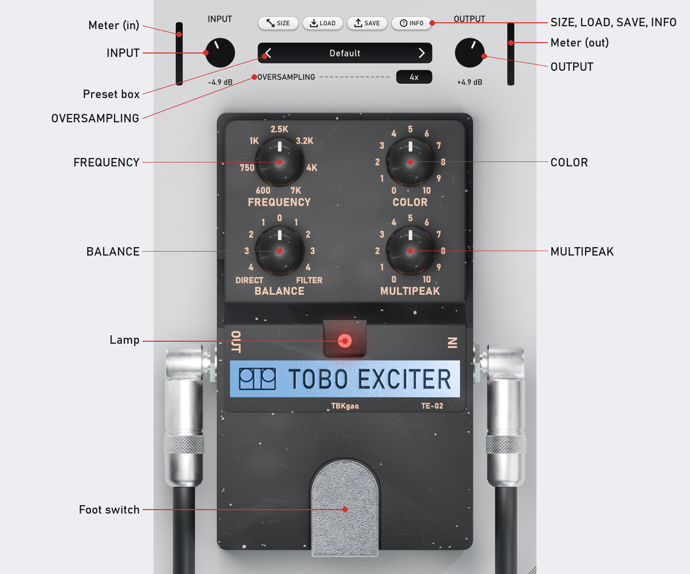

[Tobo Exciter](../README.md) › The panel

<!-- Generated from manual/manual_en.md by tools/make_docs.py. Change the source, not this file. -->

## The panel

| Part | What it does |
|---|---|
| **FREQUENCY** | Where the filter begins. The scale on the panel reads 600 Hz to 7 kHz, as on the hardware. The modeled filter moves from about 690 Hz to 6.8 kHz, matching the measurements. |
| **COLOR** | How sharp the filter's peak is. Fully left, the filter is smooth. Fully right, it rings. |
| **BALANCE** | Mixes the direct sound and the filtered sound. Fully left is the direct sound alone, and fully right is the filtered sound alone. |
| **MULTIPEAK** | Adds six fixed peaks between 1 and 5 kHz (at about 1.0, 1.4, 1.9, 2.4, 3.5 and 5.0 kHz). |
| **Foot switch** | A click turns the effect on and off. The lamp above the name plate lights while the effect is on. |
| **INPUT** | The level into the model, from -30 to +30 dB. It sets how hard the pedal is driven. |
| **OUTPUT** | The level out of the model, from -30 to +30 dB. |
| **Meters** | Left: the level into the model, after INPUT. Right: the level out of the plug-in. The bottom of each meter is -60 dB. The part above 0 dBFS is red. |
| **Preset box** | Shows the name of the preset. The arrows switch to the previous or next built-in preset. |
| **OVERSAMPLING** | Clicking cycles through 2x, 4x and 8x. |
| **SIZE** | Opens a menu with the sizes of the panel (75%, 100%, 125%, 150% and 200%). |
| **LOAD** | Loads a preset from a file. |
| **SAVE** | Saves the settings as a preset file. |
| **INFO** | Shows a short description of the plug-in and its controls. A click anywhere closes it. |

- Drag a knob up or down to turn it. A double-click sets it back to its default.
- Drag the lower right corner of the window to make the panel larger or smaller. The proportions stay the same. The size is saved with the project.

### INPUT and OUTPUT at their defaults

The pedal reacts to the level of the guitar: a louder signal clips more. The defaults (INPUT -4.9 dB, OUTPUT +4.9 dB) match the recording setup the model was checked with. Your recordings may be louder or quieter than that. If the effect is too tame, raise INPUT and lower OUTPUT by the same amount. If it is too harsh, do the opposite.

---

← [Quick start](quick-start.md)   |   [Contents](../README.md#documentation)   |   [Presets and preset files](presets-and-preset-files.md) →
